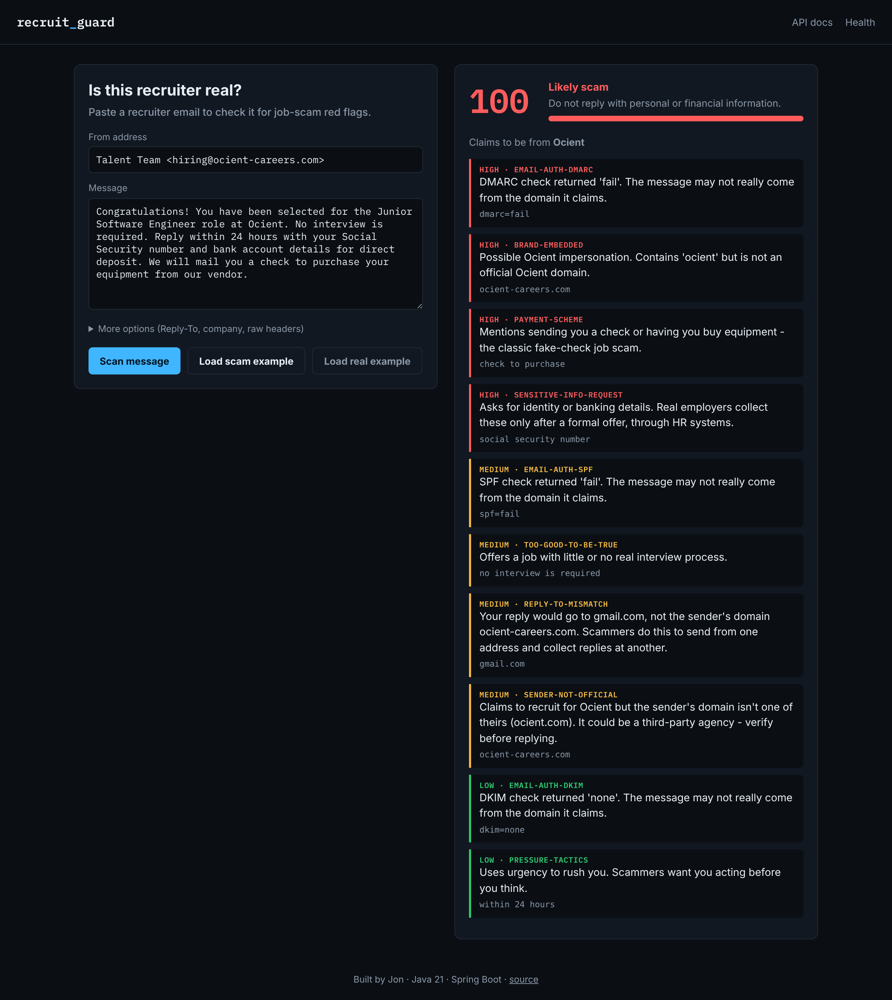

# Recruit Guard


**A Spring Boot REST API and web dashboard that scores recruiter emails for job-scam red flags.**

Paste in a recruiter's email and Recruit Guard checks the sender's domain for company impersonation, scans the message for the patterns scammers rely on, reads the email's SPF/DKIM/DMARC authentication results, and returns a 0-100 risk score that explains every point.



## Why I built this

During my own job search, I was contacted by a "recruiter" for Ocient who was actually writing from a spoofed look-alike domain. I caught it because I checked the domain by hand, but most people wouldn't think to. Job seekers, especially new grads applying to dozens of roles, are exactly who these scams target, and the warning signs are usually detectable by a program.

So I turned the checks I was doing by hand into software: *Is this really the company's domain? Why does the reply go to Gmail? Why do they want my SSN before an offer?*

## Features

| Check | What it catches | Example |
|---|---|---|
| Look-alike characters | Digits swapped for letters | `0cient.com`, `rnicrosoft.com` |
| Typosquatting | Domains 1-2 edits away (Levenshtein distance) | `ocint.com` |
| Brand embedding | Real name plus extra words | `ocient-careers.com` |
| Suffix swap | Right name, wrong ending | `ocient.co` |
| Subdomain trick | Brand hidden in front of another domain | `ocient.com.hr-portal.net` |
| Sender mismatch | "Google recruiter" on a personal Gmail | `google.team@gmail.com` |
| Reply-To mismatch | Replies secretly routed elsewhere | From `acme.com`, Reply-To `gmail.com` |
| Email authentication | Failed SPF / DKIM / DMARC | `dmarc=fail` |
| Sensitive data requests | SSN, bank, routing, license before an offer | "send your SSN" |
| Payment schemes | Fake checks, gift cards, crypto, "training fees" | "deposit the check" |
| Off-platform interviews | Telegram / WhatsApp "interviews" | "interview over Telegram" |
| Pressure tactics | Manufactured urgency | "within 24 hours" |

## Tech stack

- **Java 21** (records, switch expressions, text blocks)
- **Spring Boot 3.5** - REST API, dependency injection, Bean Validation
- **springdoc-openapi** - interactive Swagger docs at `/docs`
- **Spring Boot Actuator** - `/actuator/health` endpoint
- **JUnit 5, AssertJ, MockMvc** - 49 tests, unit and integration
- **JaCoCo** - coverage report; the build fails below 80% (currently 97% line, 92% branch)
- **GitHub Actions** - builds, tests, and builds the Docker image on every push
- **Docker** - multi-stage build, runs as a non-root user with a health check

## Architecture

```
Browser / API client
        |
        v
ScanController  (REST layer: routing, validation, error format)
        |
        v
ScanService     (runs every rule, sorts findings, computes score)
        |
        v
List<ScanRule>  (each check is its own class, injected by Spring)
   |-- ImpersonationRule --> DomainAnalyzer --> DomainUtils, CompanyDirectory
   |-- SenderMismatchRule
   |-- ReplyToMismatchRule
   |-- EmailAuthenticationRule
   '-- KeywordRule subclasses (sensitive info, payment, off-platform, urgency, too-good-to-be-true)
```

**Adding a new check takes one new class.** Every rule implements `ScanRule` and is a Spring `@Component`, so Spring automatically injects it into `ScanService`. Nothing else changes.

Scoring is deliberately transparent: HIGH = 30 points, MEDIUM = 15, LOW = 5, capped at 100. A score of 50+ is "Likely scam", 20-49 is "Suspicious". Anyone can see why a message got its score.

## Running it

**With Maven** (Java 21 required):

```bash
mvn spring-boot:run
```

**With Docker:**

```bash
docker build -t recruit-guard .
docker run -p 8080:8080 recruit-guard
```

Then open:

- http://localhost:8080 - dashboard
- http://localhost:8080/docs - interactive API docs
- http://localhost:8080/actuator/health - health check

**Run the tests and coverage report:**

```bash
mvn verify
# report: target/site/jacoco/index.html
```

## API

### `POST /api/v1/scan`

```bash
curl -X POST localhost:8080/api/v1/scan \
  -H "Content-Type: application/json" \
  -d '{
    "sender": "Talent Team <hiring@ocient-careers.com>",
    "replyTo": "ocient.hr@gmail.com",
    "body": "You have been selected at Ocient. Send your SSN within 24 hours."
  }'
```

```json
{
  "score": 95,
  "verdict": "LIKELY_SCAM",
  "claimedCompany": "Ocient",
  "findings": [
    {
      "ruleId": "brand-embedded",
      "severity": "HIGH",
      "message": "Possible Ocient impersonation. Contains 'ocient' but is not an official Ocient domain.",
      "evidence": "ocient-careers.com"
    }
  ]
}
```

| Field | Required | Description |
|---|---|---|
| `sender` | yes | From address |
| `body` | yes | Message text |
| `replyTo` | no | Reply-To address |
| `claimedCompany` | no | Company they claim to represent (detected from the body if blank) |
| `headers` | no | Raw email headers, for SPF/DKIM/DMARC checks |

Invalid input returns `400` in the standard [RFC 9457](https://www.rfc-editor.org/rfc/rfc9457) problem-details format.

### `GET /api/v1/domains/check?domain=ocient.co`

Checks a single domain for impersonation.

### `GET /api/v1/companies`

Lists the companies the scanner knows. To add one, edit [`companies.json`](src/main/resources/companies.json); no code changes needed.

## What I'd add next

- Look up real domain age through WHOIS/RDAP (scam domains are often days old)
- Accept a full `.eml` file upload and parse headers automatically
- A browser extension that scans emails right inside Gmail
- Scoring weights tuned against a labeled dataset of real scam reports

## License

MIT
